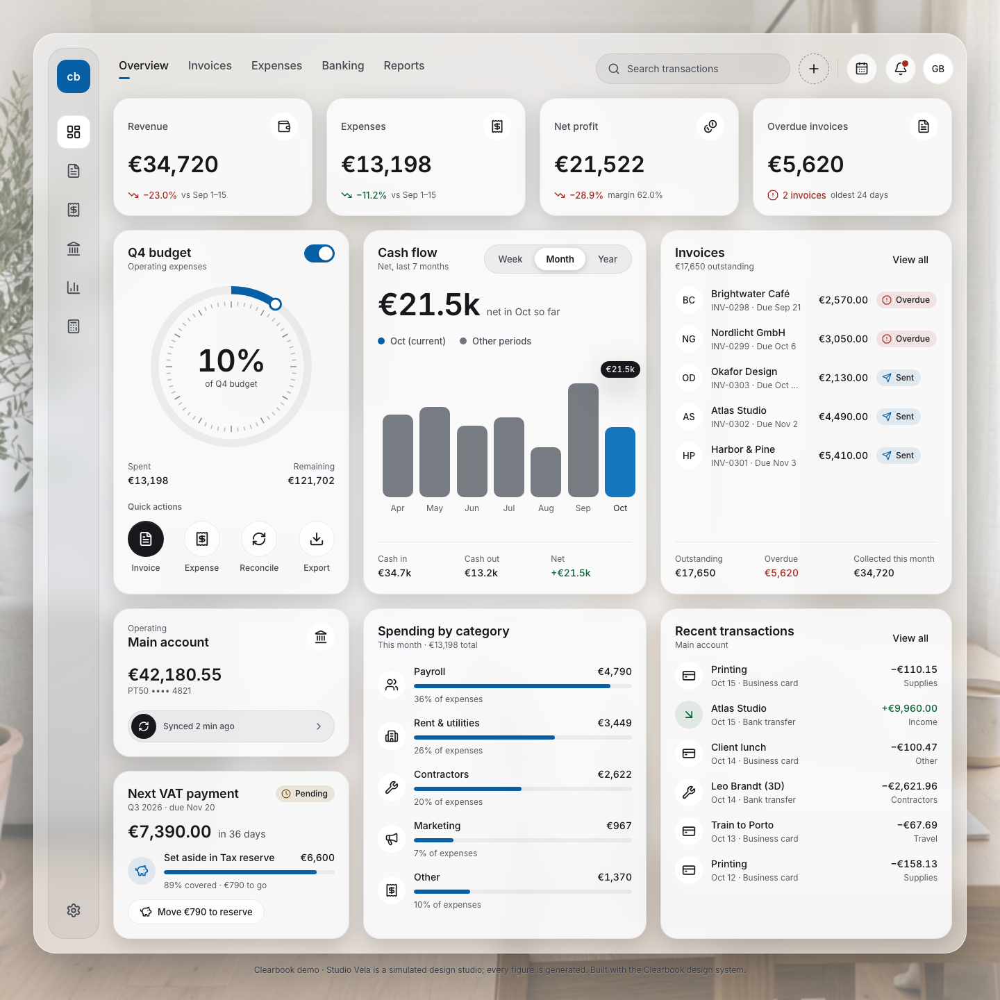
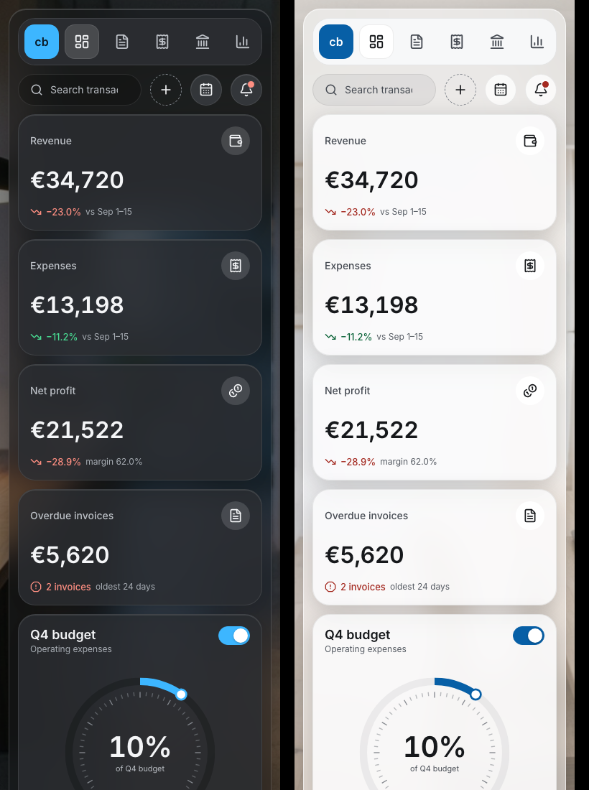

# Clearbook

[](https://github.com/guiboorges/clearbook/actions/workflows/ci.yml) [](https://github.com/guiboorges/clearbook/actions/workflows/pages.yml) [](https://guiboorges.github.io/clearbook/) [](https://github.com/guiboorges/clearbook/releases/latest) [](LICENSE) [](https://claude.com/claude-code)

A working accounting dashboard for a small design studio, built with the **Clearbook** glass design system. It runs
on a simulated business in your browser: send invoices, mark them paid, add expenses, set money aside for VAT, and
watch revenue, the budget, cash flow, and the bank balance respond.

**[▶ Open the live demo](https://guiboorges.github.io/clearbook/)**


| Light mode | Phone (dark and light) |
|---|---|
|  |  |

## What works

- **KPIs:** revenue, expenses, and net profit for the month so far, compared with the same days of last month, plus overdue invoices and how old the oldest is.
- **Invoices:** statuses follow the calendar (sent, pending in the last 7 days, overdue, paid). Open one to mark it paid or send a reminder. Create invoices or drafts and send them later. Now and then a client pays on their own.
- **Expenses:** add one and it lands in recent transactions, spending by category, the quarterly budget, and the balance. With alerts on, you get a notification when the budget passes 90%.
- **Cash flow:** net cash by week, month, or year. Select any bar to see its cash in, cash out, and net; a hidden table gives screen readers the same numbers.
- **Tax:** the next quarterly VAT payment (due on the 20th of the second month after the quarter) and how much of it the Tax reserve covers. Move the shortfall in one click.
- **Everywhere:** reconcile the accounts, export this month's transactions as CSV, search transactions (`⌘K`), upcoming due dates, notifications, a light/dark switch (it follows your system by default), and a reset button. Your changes are saved in the browser (`localStorage`).

> The business is simulated. Studio Vela, its clients, and every figure are generated; no bank is connected and nothing leaves your browser. The history is built from a seed per day, so it is the same on every reload and for every visitor; your own actions are added on top.

## The design system

Clearbook was designed in Figma before any code: variables for color (Dark and Light modes), spacing, and radius, 14
text styles, 5 glass and elevation effects, 20 components, 43 icons, card patterns, and the Overview in both modes.
The tokens and the generated `clearbook.tokens.css` live in the
[design-studio library](https://github.com/guiboorges/design-studio/tree/main/library/design-systems/clearbook);
`src/styles/clearbook.tokens.css` is a copy of that file.

- Glass is the chrome, the numbers sit on cards that stay readable: contrast was measured on rendered pixels where the photo shows through, and every text role passes WCAG 2.2 AA in both modes.
- One blue accent marks the main action, the active state, and the current period. Status colors always come with an icon and a sign or a label.
- Glass turns opaque under `prefers-reduced-transparency` or without `backdrop-filter`, and motion stops under `prefers-reduced-motion`.

The studio photos were generated with Figma AI. Icons are [Lucide](https://lucide.dev) (ISC). The typeface is
[Inter](https://rsms.me/inter/) (OFL).

## Run it

```bash
npm install
npm run dev     # http://localhost:5173
npm test        # simulation tests
npm run build   # static site in dist/
```

React 19, TypeScript, and Vite, with no backend. The simulation is in `src/sim/`: `ledger.ts` generates the bank feed
and the aggregates, `books.ts` holds invoices, VAT, the budget, and every action as pure functions, and `useBooks.ts`
holds the state and the clock. The cards are in `src/components/`.

## License

[MIT](LICENSE) © 2026 Guilherme Borges
